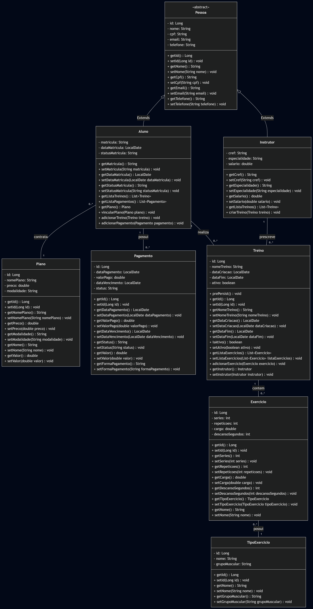

# IRONCORE — Sistema de Gestão de Academia 🏋️‍♂️

Aplicação web full-stack para gerenciar as operações de uma academia: alunos, instrutores, planos, pagamentos, treinos e exercícios. API REST em **Java / Spring Boot** com **PostgreSQL** e interface em **Next.js (React) + Tailwind CSS**.

Projeto desenvolvido na disciplina de Programação Orientada a Objetos (UFAPE).

<!-- Quando tiver prints, salve em docs/ e troque este comentário pela imagem: -->
<!--  -->

## 🚀 Funcionalidades

- CRUD completo de **alunos**, **instrutores**, **planos**, **pagamentos**, **treinos**, **exercícios** e **tipos de exercício**
- Treinos vinculados a um instrutor e compostos por uma lista de exercícios
- Alunos associados a um plano, a treinos e a pagamentos
- Busca de alunos e instrutores por CPF ou por ID
- Validação dos dados de entrada (Bean Validation) com mensagens de erro na API
- Interface web com tema escuro

## 🧱 Arquitetura

Back-end em camadas, com POO e o padrão Fachada. O código fica em `src/main/java/br/edu/ufape/poo/academia/`:

```
comunicacao/  → controllers REST, DTOs (request/response), conversores e tratamento de exceções
negocio/      → entidades (basico), regras de cadastro, exceções de negócio e Fachada
dados/        → repositórios Spring Data JPA
```

Modelo de dados: `Aluno` e `Instrutor` herdam de `Pessoa`. O `Aluno` possui um `Plano`, uma lista de `Treino` e uma lista de `Pagamento`. Cada `Treino` pertence a um `Instrutor` e tem uma lista de `Exercicio`, e cada `Exercicio` tem um `TipoExercicio`.



## 🛠️ Tecnologias

| Camada | Tecnologias |
|--------|-------------|
| Back-end | Java 17, Spring Boot 3.2, Spring Data JPA, Bean Validation, Maven |
| Banco de dados | PostgreSQL |
| Front-end | Next.js, React, Tailwind CSS |
| Testes | JUnit 5, Spring Boot Test |
| Teste de API | Insomnia (`docs/insomnia-collection.yaml`) |

## ✅ Pré-requisitos

- Java 17 ou superior
- Node.js 20 ou superior
- PostgreSQL
- Maven (já incluso via `mvnw`)

## ⚙️ Como executar

### 1. Clonar

```bash
git clone https://github.com/JoseBreno2026/academia.git
cd academia
```

### 2. Banco de dados

Crie o banco e um usuário no PostgreSQL:

```sql
CREATE DATABASE academia_bd;
CREATE USER poo2026 WITH PASSWORD 'sua_senha_aqui';
GRANT ALL PRIVILEGES ON DATABASE academia_bd TO poo2026;
```

> No PostgreSQL 15 ou superior, pode ser necessário também: `\c academia_bd` e `GRANT ALL ON SCHEMA public TO poo2026;`

As tabelas são criadas automaticamente na primeira execução (`ddl-auto=update`).

### 3. Variáveis de ambiente do back-end

A senha **não** fica no código. Defina as variáveis antes de subir a API (veja `.env.example`):

| Variável | Padrão | Descrição |
|----------|--------|-----------|
| `DB_URL` | `jdbc:postgresql://localhost:5432/academia_bd` | URL do banco |
| `DB_USER` | `poo2026` | usuário do banco |
| `DB_PASSWORD` | *(vazio)* | **senha do banco — obrigatória** |
| `SERVER_PORT` | `8081` | porta da API |

Windows (PowerShell):
```powershell
$env:DB_PASSWORD="sua_senha_aqui"
```

Linux/macOS:
```bash
export DB_PASSWORD=sua_senha_aqui
```

Na IDE (Eclipse/STS): *Run Configurations → Environment* e adicione `DB_PASSWORD`.

> A variável vale apenas para o terminal em que foi definida. Rode a API nesse mesmo terminal.

### 4. Subir o back-end

Na pasta raiz do projeto:

```bash
./mvnw spring-boot:run          # Windows (PowerShell): .\mvnw.cmd spring-boot:run
```

A API sobe em http://localhost:8081.

### 5. Subir o front-end

Em outro terminal:

```bash
cd frontend
npm install
npm run dev
```

Acesse http://localhost:3000. Para apontar para outra URL de API, veja `frontend/.env.example`.

## 🔌 Endpoints

Base: `http://localhost:8081`

| Recurso | Rota base | Operações |
|---------|-----------|-----------|
| Alunos | `/alunos` | `GET /` · `GET /{cpf}` · `GET /id/{id}` · `POST /` · `PUT /{id}` · `DELETE /{id}` |
| Instrutores | `/instrutores` | `GET /` · `GET /{cpf}` · `GET /id/{id}` · `POST /` · `PUT /{id}` · `DELETE /{id}` |
| Planos | `/api/planos` | `GET` · `GET /{id}` · `POST` · `PUT /{id}` · `DELETE /{id}` |
| Pagamentos | `/api/pagamentos` | `GET` · `GET /{id}` · `POST` · `PUT /{id}` · `DELETE /{id}` |
| Treinos | `/api/treinos` | `GET` · `GET /{id}` · `POST` · `PUT /{id}` · `DELETE /{id}` |
| Exercícios | `/api/exercicios` | `GET` · `GET /{id}` · `POST` · `PUT /{id}` · `DELETE /{id}` |
| Tipos de exercício | `/api/tipos-exercicios` | `GET` · `GET /{id}` · `POST` · `PUT /{id}` · `DELETE /{id}` |

Exemplos de requisições prontas estão em `docs/insomnia-collection.yaml` (importe no Insomnia).

## 🧪 Testes

```bash
./mvnw test                     # Windows (PowerShell): .\mvnw.cmd test
```

> ⚠️ Os testes de integração usam o PostgreSQL configurado (ele precisa estar rodando, com `DB_PASSWORD` definida) e **gravam dados no banco**. Use um banco de desenvolvimento, nunca um com dados importantes.

## 📚 Aprendizados

- Modelagem de entidades, herança e relacionamentos com JPA/Hibernate
- Construção de API REST em camadas com DTOs, conversores e tratamento de exceções
- Integração entre front-end Next.js (Server Actions) e back-end Java

## 👥 Autores

- José Breno da Silva Almeida ([@JoseBreno2026](https://github.com/JoseBreno2026))
- José Almeida de Freitas Neto ([@josealmeidatech](https://github.com/josealmeidatech))
- Lennarth Conrado Vasconcelos Ventura Andrade ([@Lennarth2026](https://github.com/Lennarth2026))
